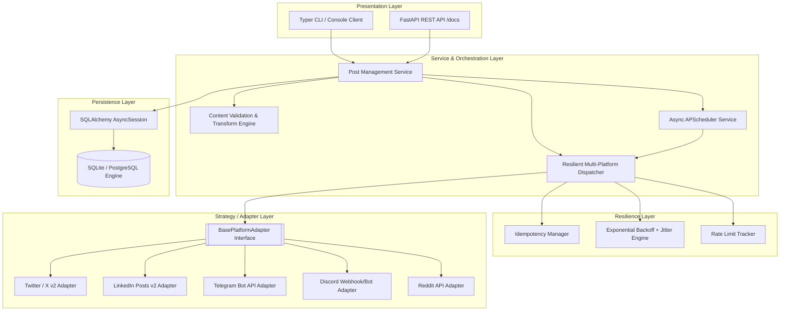

# Technical Requirements Document (TRD)
## Project: AutoPost Nexus — Automated Multi-Platform Posting System
**Company / Assessment:** Dxora Technologies Python Practical Test  
**Document Version:** 1.0.0  
**Status:** Approved for Implementation  
**Role:** Senior Software Architect & Lead Backend Engineer  

---

### 1. Technology Stack Selection & Rationales

| Layer | Technology | Version | Architectural Rationale |
|---|---|---|---|
| **Language** | Python | 3.12+ (Tested on 3.14) | Industry standard for backend orchestration, asynchronous networking, and API integration. |
| **API Framework** | FastAPI | >= 0.115.0 | High performance, native `asyncio` support, automated OpenAPI (Swagger/ReDoc) generation, strict Pydantic v2 validation. |
| **Data Validation** | Pydantic | >= 2.9.0 | Compile-time and runtime data validation, strict typing, schema serialization. |
| **Configuration** | Pydantic-Settings | >= 2.6.0 | Typed, validated 12-factor application settings loaded from environment and `.env` files. |
| **ORM / Storage** | SQLAlchemy 2.0 | >= 2.0.36 | Modern async-first syntax (`select`, `sessionmaker(class_=AsyncSession)`), agnostic database dialect support. |
| **Database Driver** | aiosqlite | >= 0.20.0 | Pure async SQLite driver enabling zero-friction local execution without installing external database servers, while retaining compatibility with `asyncpg` for PostgreSQL. |
| **HTTP Client** | HTTPX | >= 0.27.0 | Modern async HTTP client supporting HTTP/2, connection pooling, timeout configurations, and comprehensive mocking compatibility. |
| **Job Scheduling** | APScheduler | >= 3.10.4 | In-process, rock-solid async job scheduler supporting interval, cron, and one-time date triggers with persistent job stores. |
| **CLI Framework** | Typer + Rich | >= 0.12.0 / >= 13.0.0 | Beautiful terminal presentation, type-hinted command parsing, colored status tables, and interactive prompts. |
| **Testing Harness**| Pytest, Pytest-Asyncio, Respx | Latest | Fully hermetic integration testing with wire-level HTTP request/response simulation, avoiding any live credential leaks or network flakiness. |
| **Code Quality** | Ruff & Mypy | Latest | High-speed linting, formatting, and strict static type checking. |

---

### 2. System Architecture & Component Interactions

---

### 3. API Integrations Specification

#### 3.1 X / Twitter API (v2)
- **Base URL:** `https://api.twitter.com/2`
- **Authentication:** OAuth 1.0a User Context (API Key, API Secret, Access Token, Access Secret) or OAuth 2.0 User Context Bearer Token.
- **Endpoints:**
  - `POST /2/tweets` (Create a Tweet)
  - `POST https://upload.twitter.com/1.1/media/upload.json` (Media upload)
- **Constraints:** Max 280 characters (plain UTF-8 text count with URL weighting of 23 chars).

#### 3.2 LinkedIn API (Community Management / Posts API)
- **Base URL:** `https://api.linkedin.com/v2`
- **Authentication:** OAuth 2.0 Bearer Token with `w_member_social` or `w_organization_social` scope.
- **Endpoints:**
  - `POST /v2/ugcPosts` or `POST /v2/posts` (Publish authored post with commentary, media, and visibility settings).
  - `POST /v2/assets?action=registerUpload` (Register media upload).
- **Constraints:** Max 3,000 characters; requires explicit author URN (`urn:li:person:...` or `urn:li:organization:...`).

#### 3.3 Telegram Bot API
- **Base URL:** `https://api.telegram.org/bot<token>`
- **Authentication:** Bot Token embedded in HTTP endpoint path.
- **Endpoints:**
  - `POST /sendMessage` (Parameters: `chat_id`, `text`, `parse_mode=HTML` or `MarkdownV2`).
  - `POST /sendPhoto` (Parameters: `chat_id`, `photo`, `caption`).
- **Constraints:** Max 4,096 characters per message; strict HTML/Markdown entity escaping.

#### 3.4 Discord Webhook & Channel API
- **Base URL:** `https://discord.com/api/v10`
- **Authentication:** Webhook URL Token or Bot Token (`Bot <token>`).
- **Endpoints:**
  - `POST /webhooks/{webhook.id}/{webhook.token}` or `POST /channels/{channel.id}/messages`
- **Constraints:** Max 2,000 characters in message content; support for rich embeds (Title, Description, Color, Images).

#### 3.5 Reddit API
- **Base URL:** `https://oauth.reddit.com`
- **Authentication:** OAuth 2.0 with User Agent, Client ID, Client Secret, Username, Password.
- **Endpoints:**
  - `POST /api/submit` (Parameters: `sr` [subreddit], `kind` [self/link], `title`, `text`).
- **Constraints:** Title required (max 300 characters); body text supports standard Markdown.

---

### 4. Resiliency, Fault Tolerance & Concurrency

1. **Parallel Non-Blocking Fan-Out:**
   - Broadcasts are dispatched using `asyncio.gather(*tasks, return_exceptions=True)`.
   - A semaphore bounds total concurrent network connections (default: 10).
2. **Exponential Backoff with Full Jitter:**
   - Calculation formula:
     $$\text{sleep} = \min(\text{max\_backoff}, \text{base} \times 2^{\text{attempt}}) \times \text{uniform}(0.8, 1.2)$$
   - Automatically inspects HTTP `Retry-After` header when receiving HTTP 429.
3. **Idempotency Engine:**
   - Client may supply an `Idempotency-Key` or the system hashes `(title + content + sorted(targets) + scheduled_timestamp)`.
   - Repeated submissions within the deduplication window return the existing post record instead of triggering redundant API calls.
4. **Target-Level Isolation:**
   - Database records a separate `post_targets` row for each platform.
   - Status transitions are atomic: `PENDING` -> `PUBLISHING` -> `SUCCESS` or `FAILED`.
   - A post with 3 successful targets and 1 failed target is marked `PARTIALLY_FAILED`.
   - The `/api/v1/posts/{id}/retry` endpoint queries `SELECT * FROM post_targets WHERE post_id = :id AND status = 'FAILED'` and dispatches *only* to those targets.

---

### 5. Security & Configuration Architecture
- **Zero Secrets in Code:** All credentials configured via `.env` loaded into a strictly validated `PydanticSettings` class:
  - `TWITTER_API_KEY`, `TWITTER_API_SECRET`, `TWITTER_ACCESS_TOKEN`, `TWITTER_ACCESS_SECRET`
  - `LINKEDIN_ACCESS_TOKEN`, `LINKEDIN_AUTHOR_URN`
  - `TELEGRAM_BOT_TOKEN`, `TELEGRAM_CHAT_ID`
  - `DISCORD_WEBHOOK_URL`
  - `REDDIT_CLIENT_ID`, `REDDIT_CLIENT_SECRET`, `REDDIT_USERNAME`, `REDDIT_PASSWORD`
- **Secret Masking:** Logging formatters and audit log serializers automatically mask Bearer tokens, secrets, and auth headers (e.g. `Bearer *******3b9a`).
- **Input Sanitization:** Text inputs are validated and sanitized to prevent injection attacks and encoding discrepancies across operating systems.

---

### 6. Deployment & Runtime Requirements
- Standard Python 3.12+ runtime.
- Works on Windows, macOS, and Linux without OS-specific native dependencies.
- Can run standalone via CLI or containerized as a Docker microservice exposing port 8000.
