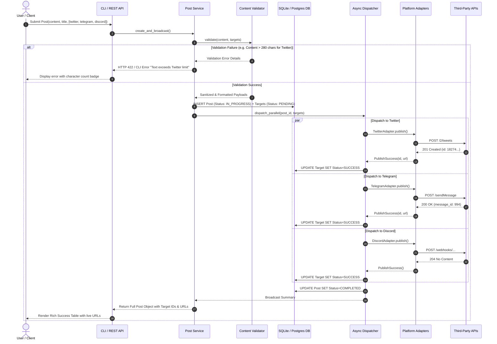
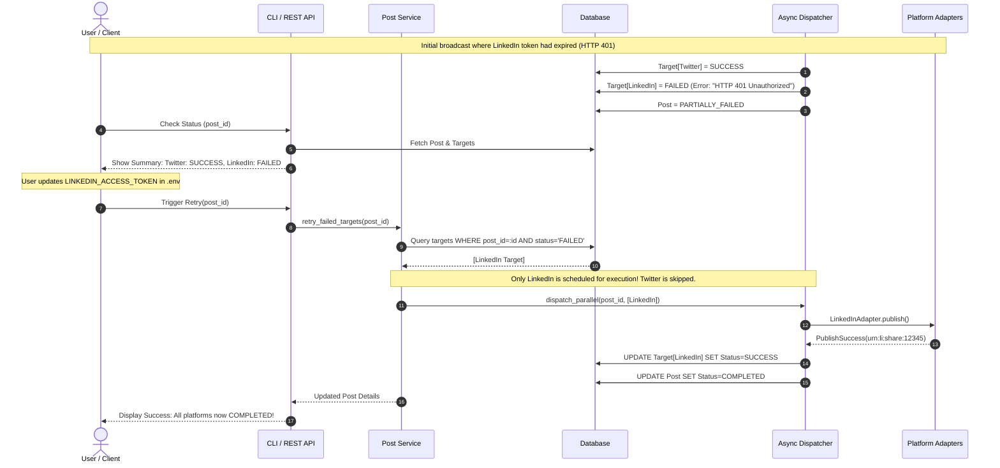
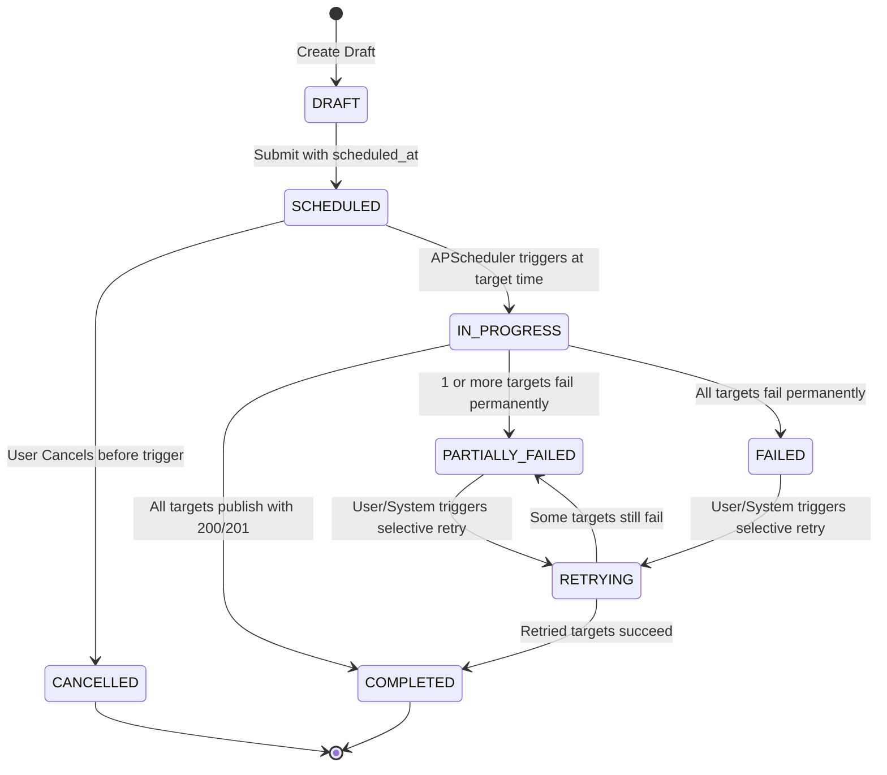

# App Flow Document
## Project: AutoPost Nexus — Automated Multi-Platform Posting System
**Company / Assessment:** Dxora Technologies Python Practical Test  
**Document Version:** 1.0.0  
**Status:** Approved for Implementation  
**Role:** UX Strategist & Lead Systems Architect  

---

### 1. Overview of System Interfaces
The application provides two unified control surfaces:
1. **The Interactive CLI Surface:** Terminal-first operations for quick publishing, batch operations, system health checks, and scheduled job inspections.
2. **The REST API Surface (Swagger UI / ReDoc):** Programmatic HTTP endpoints with an interactive browser dashboard at `/docs` allowing visual parameter input, execution, and JSON inspection.

---

### 2. End-to-End User Journey Maps

#### Flow A: Immediate Multi-Platform Broadcast

---

#### Flow B: Handling Partial Failure & Selective Retry

---

#### Flow C: Scheduled Post Lifecycle

---

### 3. Screen, Route & Command Specifications

#### 3.1 REST API Routes (Swagger UI at `/docs`)
| Method | Route | Description | Success Response | Error Responses |
|---|---|---|---|---|
| `POST` | `/api/v1/posts` | Create and immediately publish or schedule a post. | `201 Created` with Post Schema | `400 Bad Request`, `422 Unprocessable Entity` |
| `GET` | `/api/v1/posts` | List posts with pagination, status filter, and platform filter. | `200 OK` (list of posts + total count) | `400 Bad Request` |
| `GET` | `/api/v1/posts/{id}` | Retrieve comprehensive post status, target breakdowns, and logs. | `200 OK` (detailed post object) | `404 Not Found` |
| `POST` | `/api/v1/posts/{id}/retry`| Re-attempt execution *only* for failed targets. | `200 OK` (updated post object) | `404 Not Found`, `400 No Failed Targets` |
| `DELETE` | `/api/v1/posts/{id}` | Cancel a scheduled post or delete a draft. | `200 OK` (cancellation confirmed) | `404 Not Found`, `400 Cannot Cancel Completed Post` |
| `GET` | `/api/v1/health` | Diagnostic connectivity check for all configured platform APIs. | `200 OK` (per-platform latency & status) | `503 Service Unavailable` (if critical dependencies down) |

#### 3.2 CLI Commands
- `python -m autopost_nexus.cli post "Content here" --platforms twitter,telegram,discord`
  - Action: Immediate validation and broadcast.
  - Success State: Colored table listing Platform, Status (`SUCCESS`), Post ID, and Direct Post URL.
  - Failure State: Colored table showing which platforms succeeded and exact error message for failed ones.
- `python -m autopost_nexus.cli schedule "Content here" --at "2026-11-20T10:00:00" --platforms linkedin,telegram`
  - Action: Registers post in database and schedules job with APScheduler.
  - State: Displays Scheduled confirmation with Job ID and countdown.
- `python -m autopost_nexus.cli list --limit 10`
  - Action: Renders recent posts, scheduled jobs, and statuses.
  - Empty State: "No posts found in database. Create your first post using `autopost_nexus.cli post`."
- `python -m autopost_nexus.cli retry <post_id>`
  - Action: Selectively replays only the failed target platforms for that post ID.
- `python -m autopost_nexus.cli health`
  - Action: Pings and authenticates with all configured external platform APIs.
  - Output: Diagnostic matrix: Platform Name, Configured (Yes/No), Auth Test (PASS/FAIL), Latency (ms).

---

### 4. Edge Cases & Error States
1. **Network Timeout:** Handled by HTTP client timeout (default 10s), logged as `TIMEOUT`, retried up to 3 times with exponential backoff before transitioning to `FAILED`.
2. **HTTP 429 Rate Limit:** System checks for `Retry-After` header. If <= 60 seconds, it pauses and retries; if > 60 seconds, it marks target as `FAILED (Rate Limit Exceeded: Retry After X s)` to avoid blocking the worker thread.
3. **Invalid File Format / Large Media:** Handled immediately in the pre-flight validation phase before any API call is initiated, returning clean actionable feedback.
4. **Duplicate Submission:** Idempotency manager returns existing post record with HTTP 200 and a header `X-Idempotent-Replay: true`.
