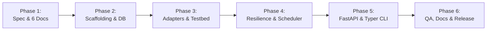

# Implementation Plan
## Project: AutoPost Nexus — Automated Multi-Platform Posting System
**Company / Assessment:** Dxora Technologies Python Practical Test  
**Document Version:** 1.0.0  
**Status:** Approved for Implementation  
**Role:** Lead Project Manager & Senior Full-Stack Engineer  

---

### 1. Phased Build Sequence Overview

To ensure production-grade quality, zero regressions, and strict adherence to the assignment requirements, the build is divided into six strictly sequential, verifiable phases.

---

### 2. Phase-by-Phase Breakdown & Deliverables

#### **Phase 1: Product Clarity, Architecture & 6 Essential Documents**
- **Status:** COMPLETED.
- **Deliverables:**
  1. `docs/01_PRD.md` — Product Requirements Document.
  2. `docs/02_TRD.md` — Technical Requirements Document.
  3. `docs/03_APP_FLOW.md` — App Flow & User Journey.
  4. `docs/04_UI_UX_DESIGN_BRIEF.md` — UI/UX Design Brief (CLI & Web).
  5. `docs/05_BACKEND_SCHEMA.md` — Backend Schema Document.
  6. `docs/06_IMPLEMENTATION_PLAN.md` — Implementation Plan.
- **Exit Gate:** User reviews and approves the architectural foundation.

---

#### **Phase 2: Project Setup, Configuration & Database Persistence Layer**
- **Objectives:** Establish clean package structure, 12-factor configuration, and async database engine with migrations and repositories.
- **Tasks:**
  - Create `pyproject.toml` and `requirements.txt` with locked dependencies.
  - Configure `autopost_nexus/config.py` using `pydantic-settings` with type safety and default fallback values.
  - Implement SQLAlchemy 2.0 async models (`Post`, `PostTarget`, `MediaAsset`, `PublishAuditLog`) in `autopost_nexus/db/models.py`.
  - Implement session management, engine lifecycle, and automatic table creation in `autopost_nexus/db/session.py`.
  - Build `PostRepository` and `AuditLogRepository` in `autopost_nexus/db/repository.py` for atomic CRUD operations.
  - Implement unit tests covering database schema creation, cascade deletions, constraints, and repository methods.
- **Exit Gate:** `pytest tests/test_db.py` passes with 100% success.

---

#### **Phase 3: Multi-Platform Adapter Engine & Content Validation Pipeline**
- **Objectives:** Develop third-party API adapters using the Strategy Pattern with wire-level mocked HTTP tests.
- **Tasks:**
  - Define `BasePlatformAdapter` abstract base class with methods: `validate_content()`, `publish()`, `check_health()`.
  - Implement **Twitter / X v2 Adapter** (`autopost_nexus/adapters/twitter.py`).
  - Implement **LinkedIn v2 Adapter** (`autopost_nexus/adapters/linkedin.py`).
  - Implement **Telegram Bot Adapter** (`autopost_nexus/adapters/telegram.py`).
  - Implement **Discord Webhook/Bot Adapter** (`autopost_nexus/adapters/discord.py`).
  - Implement **Reddit OAuth2 Adapter** (`autopost_nexus/adapters/reddit.py`).
  - Implement `ContentValidationService` with platform-specific rules (character limits, URLs, hashtags).
  - Build a comprehensive `respx` WireMock test suite covering successful publishing (200/201), bad request errors (400), auth failure (401), rate limits (429), and server errors (500/503).
- **Exit Gate:** `pytest tests/test_adapters.py` and `pytest tests/test_validation.py` pass with 100% success.

---

#### **Phase 4: Async Dispatcher, Resilience Engine & Scheduler**
- **Objectives:** Build the concurrent broadcast engine with fault isolation, exponential backoff, and persistent scheduling.
- **Tasks:**
  - Implement `BroadcastDispatcher` in `autopost_nexus/services/dispatcher.py` utilizing `asyncio.gather` with connection pooling.
  - Implement `ResilienceEngine` in `autopost_nexus/services/resilience.py`:
    - Full jitter exponential backoff.
    - Rate limit tracking (parsing `Retry-After`).
    - Partial failure isolation (per-target state recording).
    - Idempotency deduplication manager.
  - Implement `SchedulerService` in `autopost_nexus/services/scheduler.py` using APScheduler with async executors.
  - Write tests for concurrent dispatch, selective retry, and scheduled execution.
- **Exit Gate:** `pytest tests/test_dispatcher.py` and `pytest tests/test_scheduler.py` pass with 100% success.

---

#### **Phase 5: Application Interfaces — REST API (FastAPI) & Interactive CLI (Typer)**
- **Objectives:** Expose all core operations through both a high-performance REST API and a developer-friendly CLI.
- **Tasks:**
  - Build FastAPI application in `autopost_nexus/api/`:
    - `POST /api/v1/posts` (create/broadcast/schedule)
    - `GET /api/v1/posts` (list with filters)
    - `GET /api/v1/posts/{id}` (detail with per-platform targets and audit logs)
    - `POST /api/v1/posts/{id}/retry` (selective retry of failed targets)
    - `DELETE /api/v1/posts/{id}` (cancel scheduled post)
    - `GET /api/v1/health` (live platform diagnostic endpoint)
  - Configure Swagger documentation with rich metadata, tags, and request examples.
  - Build Typer CLI in `autopost_nexus/cli.py` with Rich console formatting (`post`, `schedule`, `list`, `retry`, `health`).
  - Write API end-to-end tests using `httpx.AsyncClient` and CLI tests using Typer `CliRunner`.
- **Exit Gate:** `pytest tests/test_api.py` and `pytest tests/test_cli.py` pass with 100% success.

---

#### **Phase 6: Quality Assurance, Production Hardening & Documentation**
- **Objectives:** Finalize code quality, static typing, comprehensive documentation, and delivery artifacts.
- **Tasks:**
  - Run `ruff check` and `ruff format` to guarantee clean code standards.
  - Run `mypy` strict type checking across the entire codebase.
  - Produce comprehensive documentation:
    - `README.md` (Quickstart, Features, Environment Setup, Testing, Architecture Overview).
    - `ARCHITECTURE.md` (Design decisions, trade-offs, security model).
    - `API_SPECIFICATION.md` (Full endpoint catalog with payloads).
    - `TESTING_REPORT.md` (Complete test execution summary and coverage metrics).
  - Prepare a sample `.env.example` with documented keys for real live testing.
- **Exit Gate:** All tests passing, 0 linting/type errors, complete documentation, project ready for recruitment submission.
